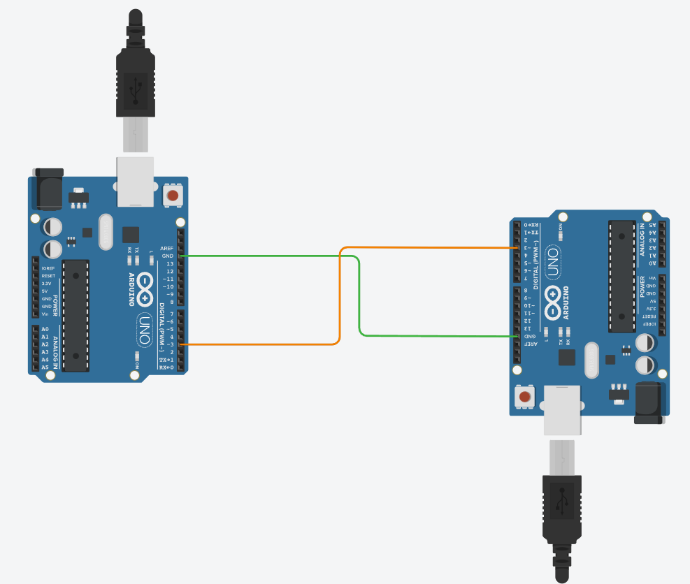
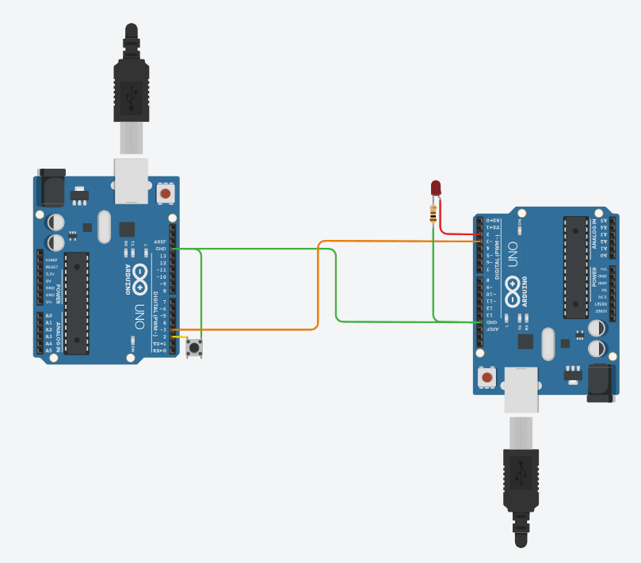

# Lihtsate signaalide saatmine kahe Arduino vahel

Ühebitise teate, näiteks nupuvajutuse, saab saata ühe Arduino digitaalväljundist teise Arduino digitaalsisendisse. Mõlema plaadi GND-viigud tuleb samuti ühendada, et signaali pinge oleks määratud ühise võrdlustaseme suhtes. Enne ühendamist lülita plaadid toitevabaks. Joonis ja simulatsioon kasutavad 5 V loogikatasemega UNO R3 plaate; sama ühendus töötab ka UNO R4 WiFi plaatidega.



*Ühendus lihtsa digitaalsignaali edastamiseks.*

Saatja seab viigu D3 väärtuseks `HIGH` või `LOW`. Vastuvõtja loeb sama viiku D3 sisendina. See sobib üksikute olekute edastamiseks; mitme väärtuse jaoks on otstarbekam kasutada järgmises peatükis kirjeldatud jadaliidest.



Saatja nupp ühendatakse viigu D2 ja GND vahele. `INPUT_PULLUP` tõttu on vajutatud nupu väärtus `LOW`. Vastuvõtja väline LED ühendatakse viigule D2 järjestikku sobiva voolupiirava takistiga (näiteks 470 Ω).

### Saatja kood

```cpp
void setup() {
  pinMode(2, INPUT_PULLUP); // Nupp viigu D2 ja GND vahel
  pinMode(3, OUTPUT);      // Ühendus vastuvõtja D3-ga
}

void loop() {
  digitalWrite(3, digitalRead(2) == LOW ? HIGH : LOW);
}
```

### Vastuvõtja kood

```cpp
void setup() {
  pinMode(2, OUTPUT); // LED koos voolupiirava takistiga
  pinMode(3, INPUT);  // Ühendus saatja D3-ga
}

void loop() {
  digitalWrite(2, digitalRead(3));
}
```

[Interaktiivne simulatsioon](https://www.tinkercad.com/things/iG2t2hk4u0Y-lihtne-signaaliedastus?sharecode=L7F71YvCVGFMR-UxZC6i8J2CFhUY9LUxnySc3Jy4tp4)
