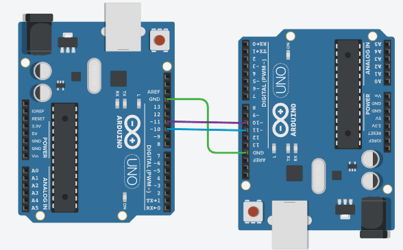

# Keerukamate andmete saatmine kahe Arduino vahel

- [Andmete edastamine jadaliidese kaudu](#andmete-edastamine-jadaliidese-kaudu)
- [JSON-vormingus andmesõnumid](#json-vormingus-andmesõnumid)
- [Andmete edastamine WiFi kaudu](#andmete-edastamine-wifi-kaudu)

Üks digitaaljuhe edastab korraga ühe kahendväärtuse. Teksti või mitut anduriväärtust on mugavam saata jadaliidese või võrgu kaudu. Allpool kasutame iga sõnumi lõpus reavahetust (`\n`), et vastuvõtja teaks, millal üks sõnum lõpeb.

## Andmete edastamine jadaliidese kaudu

UART-jadaliidesega ühendatakse saatja TX vastuvõtja RX-iga, vastuvõtja TX saatja RX-iga ning mõlema plaadi GND-viigud omavahel. Mõlemal poolel peab olema sama edastuskiirus. Enne juhtmete ühendamist lülita toide välja.

UNO R3 plaadil on D0/D1 UART jagatud USB-ühendusega, mistõttu võivad teise seadme juhtmed takistada programmi laadimist või arvutiga suhtlust. Siinses R3 näites kasutame `SoftwareSerial` teeki: `SoftwareSerial(10, 11)` tähendab RX = D10 ja TX = D11. Ühenda ühe plaadi D11 teise D10-ga ja vastupidi. R3 simulatsioonis kujutatud ühendust kontrolli koodis määratud viikude järgi.

UNO R4 WiFi plaadil on USB `Serial` ja D0/D1 `Serial1` eraldi. Ühenda ühe plaadi D1 teise D0-ga ja vastupidi. `SoftwareSerial` näited on mõeldud ainult UNO R3 jaoks.

### Näide: ping ja pong UNO R3-ga



Saatja saadab ühe rea `ping` ja vastuvõtja saadab vastu ühe rea `pong`. Mõlemas programmis peab jadapordi kiirus olema 9600.

**Saatja kood**

```cpp
#include <SoftwareSerial.h>

SoftwareSerial link(10, 11); // RX, TX

void setup() {
  Serial.begin(9600);
  link.begin(9600);
  link.setTimeout(200);
}

void loop() {
  link.println("ping");
  Serial.println("Saadetud: ping");

  unsigned long algus = millis();
  while (millis() - algus < 1000) {
    if (link.available()) {
      String vastus = link.readStringUntil('\n');
      vastus.trim();
      Serial.print("Vastus: ");
      Serial.println(vastus);
      break;
    }
  }
  delay(1000);
}
```

**Vastuvõtja kood**

```cpp
#include <SoftwareSerial.h>

SoftwareSerial link(10, 11); // RX, TX

void setup() {
  Serial.begin(9600);
  link.begin(9600);
  link.setTimeout(200);
}

void loop() {
  if (link.available()) {
    String teade = link.readStringUntil('\n');
    teade.trim();
    if (teade == "ping") {
      link.println("pong");
      Serial.println("Saadetud: pong");
    }
  }
}
```

[UNO R3 interaktiivne simulatsioon](https://www.tinkercad.com/things/aWeu8I6izJ3-ping-pong?sharecode=jb9FeLlcVBtkklh1f_wDyDHqJns84sqinYvRK5oNSmI)

### Sama näide UNO R4 WiFi-ga

Kasuta eelmisi kahte programmi järgmiste asendustega: eemalda `#include <SoftwareSerial.h>` ja `SoftwareSerial link(10, 11);` ning asenda kõik `link` nimelise objekti kasutused `Serial1` objektiga. Näiteks saab `link.begin(9600)` asemele `Serial1.begin(9600)` ja `link.setTimeout(200)` asemele `Serial1.setTimeout(200)`. Ülejäänud loogika jääb samaks. USB-jadamonitor kasutab endiselt `Serial` objekti.

## JSON-vormingus andmesõnumid

JSON (JavaScript Object Notation) lubab ühes sõnumis saata mitu nimega väärtust. Näiteks:

```json
{"temperatuur":21.5,"niiskus":60,"valgus":true,"asukoht":"elutuba"}
```

Järgmine UNO R3 näide vajab `ArduinoJson` versiooni 7 ja DHT22-anduri jaoks `DHT sensor library` teeki. Fototakisti peab olema koos sobiva takistiga pingejaguris, mille väljund on ühendatud A0-ga. `valgusePiir` sõltub pingejaguri ühendusest ja valgustingimustest; vajaduse korral muuda võrdlusmärki. Andurite näidiskoodi saab kasutada ka UNO R4 WiFi-ga, kui asendad `SoftwareSerial` eelmises jaotises kirjeldatud viisil `Serial1` objektiga.

**Saatja kood**

```cpp
#include <SoftwareSerial.h>
#include <ArduinoJson.h>
#include <DHT.h>

SoftwareSerial link(10, 11); // RX, TX
DHT dht(2, DHT22);
const int valgusViik = A0;
const int valgusePiir = 500;

void setup() {
  Serial.begin(9600);
  link.begin(9600);
  dht.begin();
}

void loop() {
  float temperatuur = dht.readTemperature();
  float niiskus = dht.readHumidity();
  if (isnan(temperatuur) || isnan(niiskus)) {
    Serial.println("DHT22 lugemisviga");
    delay(2000);
    return;
  }

  JsonDocument doc;
  doc["temperatuur"] = temperatuur;
  doc["niiskus"] = niiskus;
  doc["valgus"] = analogRead(valgusViik) > valgusePiir;
  doc["asukoht"] = "elutuba";

  serializeJson(doc, link);
  link.println(); // Üks JSON-sõnum ühel real
  serializeJson(doc, Serial);
  Serial.println();
  delay(2000);
}
```

**Vastuvõtja kood**

```cpp
#include <SoftwareSerial.h>
#include <ArduinoJson.h>

SoftwareSerial link(10, 11); // RX, TX

void setup() {
  Serial.begin(9600);
  link.begin(9600);
  link.setTimeout(300);
}

void loop() {
  if (!link.available()) return;

  String rida = link.readStringUntil('\n');
  JsonDocument doc;
  DeserializationError viga = deserializeJson(doc, rida);
  if (viga) {
    Serial.print("JSON-i lugemisviga: ");
    Serial.println(viga.c_str());
    return;
  }

  const char* asukoht = doc["asukoht"] | "tundmatu";
  Serial.print("Asukoht: "); Serial.println(asukoht);
  Serial.print("Temperatuur: "); Serial.println(doc["temperatuur"].as<float>());
  Serial.print("Niiskus: "); Serial.println(doc["niiskus"].as<float>());
  Serial.print("Valgus: "); Serial.println(doc["valgus"].as<bool>() ? "jah" : "ei");
}
```

## Andmete edastamine WiFi kaudu

See näide töötab kahe **UNO R4 WiFi** plaadiga samas WiFi-võrgus. Plaadid kasutavad `WiFiS3` teeki ning TCP-ühendust. Mõne kooli või külalisvõrgu kliendieraldus võib takistada seadmete omavahelist ühendust. Paigalda lisaks `ArduinoJson` versioon 7 ja `DHT sensor library`. Kasuta eespool kirjeldatud DHT22 ning fototakisti ühendust.

Laadi kõigepealt serveri programm ühele plaadile ja vaata selle IP-aadressi jadamonitorist. Asenda kliendi koodis `serverIP` selle aadressiga; näites olev aadress on ainult kohatäitja. Sea mõlemas programmis sama WiFi-võrgu nimi ja parool.

### Serveri kood

```cpp
#include <WiFiS3.h>
#include <ArduinoJson.h>

char ssid[] = "SINUVORK";
char pass[] = "SINUPAROOL";
WiFiServer server(5000);

void setup() {
  Serial.begin(9600);
  WiFi.begin(ssid, pass);
  while (WiFi.status() != WL_CONNECTED) delay(500);
  Serial.print("Serveri IP: ");
  Serial.println(WiFi.localIP());
  server.begin();
}

void loop() {
  WiFiClient klient = server.available();
  if (!klient) return;

  klient.setTimeout(1000);
  String rida = klient.readStringUntil('\n');
  JsonDocument doc;
  DeserializationError viga = deserializeJson(doc, rida);
  if (viga) {
    Serial.print("JSON-i lugemisviga: ");
    Serial.println(viga.c_str());
  } else {
    Serial.print("Asukoht: "); Serial.println(doc["asukoht"] | "tundmatu");
    Serial.print("Temperatuur: "); Serial.println(doc["temperatuur"].as<float>());
    Serial.print("Niiskus: "); Serial.println(doc["niiskus"].as<float>());
    Serial.print("Valgus: "); Serial.println(doc["valgus"].as<bool>() ? "jah" : "ei");
  }
  klient.stop();
}
```

### Kliendi kood

```cpp
#include <WiFiS3.h>
#include <ArduinoJson.h>
#include <DHT.h>

char ssid[] = "SINUVORK";
char pass[] = "SINUPAROOL";
IPAddress serverIP(192, 168, 1, 100); // Asenda serveri tegeliku IP-aadressiga
const uint16_t serveriPort = 5000;
DHT dht(2, DHT22);

void setup() {
  Serial.begin(9600);
  dht.begin();
  WiFi.begin(ssid, pass);
  while (WiFi.status() != WL_CONNECTED) delay(500);
}

void loop() {
  float temperatuur = dht.readTemperature();
  float niiskus = dht.readHumidity();
  if (isnan(temperatuur) || isnan(niiskus)) {
    Serial.println("DHT22 lugemisviga");
    delay(2000);
    return;
  }

  JsonDocument doc;
  doc["temperatuur"] = temperatuur;
  doc["niiskus"] = niiskus;
  doc["valgus"] = analogRead(A0) > 500;
  doc["asukoht"] = "elutuba";

  WiFiClient klient;
  if (klient.connect(serverIP, serveriPort)) {
    serializeJson(doc, klient);
    klient.println();
    klient.flush();
    klient.stop();
    Serial.println("Andmed saadetud");
  } else {
    Serial.println("Ühendus serveriga ebaõnnestus");
  }
  delay(2000);
}
```

Lisalugemiseks: [UNO R4 WiFi jadaliides ja WiFi](https://docs.arduino.cc/tutorials/uno-r4-wifi/cheat-sheet/) ning [ArduinoJson 7 üleminekujuhend](https://arduinojson.org/v7/how-to/upgrade-from-v6/).
