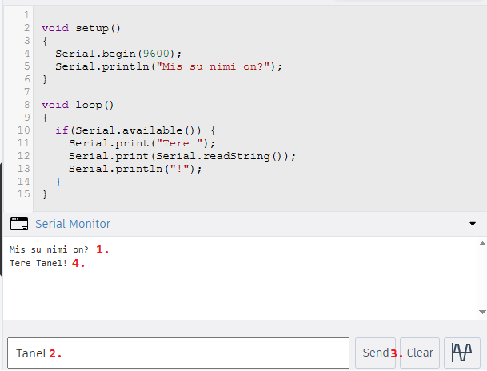

# Arduino Uno liidestamine personaalarvutiga üle jadaliidese

- [Lihtne andmevahetus arvuti ja Arduino vahel](#lihtne-andmevahetus-arvuti-ja-arduino-vahel)
- [Arduino liidestamine Processingu arenduskeskkonnaga](#arduino-liidestamine-processingu-arenduskeskkonnaga)
    - [Näide: sündmus Processingust Arduinosse](#näide-sündmus-processingust-arduinosse)
        - [Arduino kood](#arduino-kood)
        - [Processing kood](#processing-kood)
    - [Näide: andmed Arduinost Processingusse](#näide-andmed-arduinost-processingusse)
      - [Arduino kood](#arduino-kood-1)
      - [Processing kood](#processing-kood-1)

Arduino UNO suhtleb arvutiga USB-kaabli kaudu. Programmides kasutatakse selleks `Serial` objekti. UNO R3 plaadil on USB-jadaliides seotud ka viikudega D0/D1; UNO R4 WiFi plaadil on USB `Serial` ja D0/D1 `Serial1` eraldi.

USB-kaabel annab lihtsateks katsetusteks ka plaadile toite. Vali arvutis õige jadaport: Windowsis on selle nimi tavaliselt COM-port, Linuxis näiteks `/dev/ttyACM0` või `/dev/ttyUSB0` ning macOS-is `/dev/cu.*`. Sama porti ei saa tavaliselt korraga kasutada Arduino IDE jadamonitor ja Processing; sulge jadamonitor enne Processingu käivitamist.

## Lihtne andmevahetus arvuti ja Arduino vahel
Arduino IDE-s saab Serial ühendust kasutada kahes peamises kontekstis. Esiteks toimub programmide üleslaadimine plaadile just selle ühenduse kaudu. Teiseks saab Serial Monitori või Serial Plotteri abil vaadelda Arduino poolt saadetud andmeid (nt andurite väärtused, veateated vms). Selleks tuleb programmis kasutada *Serial.begin()* funktsiooni, mis määrab baudimäära ehk andmeedastuskiiruse (nt *Serial.begin(9600);*), ja *Serial.print()* või *Serial.println()* funktsioone andmete saatmiseks.

Lisaks andmete väljastamisele võimaldab jadaliidese ühendus ka andmete saatmist Arduino arendusplaadile. Näiteks saab Serial Monitori kaudu sisestada väärtusi või käske, mida Arduino suudab *Serial.read()*, *Serial.readString()* või *Serial.parseInt()* abil vastu võtta ja töödelda. See võimaldab kasutajatel reaalajas seadme käitumist mõjutada ning luua interaktiivseid süsteeme ilma lisanuppude või liidesteta.

Järgmine programm küsib kasutaja nime. Sea Arduino IDE jadamonitoris kiiruseks 9600 ja realõpuks **Newline**.

~~~cpp

void setup()
{
  Serial.begin(9600);
  Serial.setTimeout(1000);
  Serial.println("Mis su nimi on?");
}

void loop()
{
  if (Serial.available()) {
    String nimi = Serial.readStringUntil('\n');
    nimi.trim();
    if (nimi.length() == 0) return;
    Serial.print("Tere ");
    Serial.print(nimi);
    Serial.println("!");
  }
}
~~~
Jadaühendusega seotud funktsioonide kohta saad täpsemalt [lugeda siit](https://docs.arduino.cc/language-reference/en/functions/communication/serial/)

## Arduino liidestamine Processingu arenduskeskkonnaga

Sageli on tarvilik töödelda Arduino ja sellega liidestatud andurite abil saadud andmeid reaalajas või juhtida Arduino tööd läbi graafilise kasutajaliidese. 
Arduino endal kipub sellise funktsionaalsuse jaoks jõudlust väheks jääma. Lahenduseks on taaskord vahetada andmeid arvutiga, pannes oluliselt suurema jõudlusega seadme täitma funktsioone, mida Arduino ise sooritada ei jõua.

Üheks lahenduseks on [Processingu](https://processing.org/) arenduskeskkond, mille saab paigaldada Windowsi, Linuxi või macOS-i arvutisse.

Processing on avatud lähtekoodiga programmeerimiskeel ja arenduskeskkond, mis loodi visuaalse kunsti ja disaini õpetamiseks ning interaktiivsete rakenduste loomiseks. Seda kasutatakse laialdaselt visuaalsete ja interaktiivsete projektide, generatiivse kunsti, andmete visualiseerimise ning loovprogrammeerimise õpetamiseks. Processing põhineb Java programmeerimiskeelel, kuid selle süntaks on lihtsustatud, et muuta see algajatele kergemini arusaadavaks.

Processing ja Arduino suhtlevad omavahel jadaliidese kaudu. Arduino saadab andmeid USB-kaabli kaudu arvutisse, kus Processing saab neid vastu võtta ja töödelda – näiteks kuvada reaalajas andurite näitu. Samuti pakkuda graafilist kasutajaliidest Arduinol põhineva seadme juhtimiseks. See võimaldab luua interaktiivseid süsteeme, mis ühendavad füüsilise maailma ja arvutiekraani.
## Näide: sündmus Processingust Arduinosse
Näiteks võime joonistada Processingus nupu, mille vajutamine lülitab Arduino plaadil oleva sisseehitatud LED-i sisse või välja. Vaata käivitamisel Processingu konsooli prinditud portide loendit ja muuda `Serial.list()[0]` õige pordi indeksiks.
### Arduino kood
~~~cpp
const int ledPin = LED_BUILTIN; // Plaadil olev LED

void setup() {
  pinMode(ledPin, OUTPUT);
  Serial.begin(9600);
}

void loop() {
  if (Serial.available()) { //kui Serial ühenduse peale on saadetud andmeid
    char command = Serial.read(); // Loeme ühe märgi
    if (command == '1') { 
      digitalWrite(ledPin, HIGH); // Lülita LED sisse
    } else if (command == '0') {
      digitalWrite(ledPin, LOW); // Lülita LED välja
    }
  }
}
~~~

### Processing kood
~~~java
import processing.serial.*;

// Serial-ühenduse objekt
Serial myPort;

// Muutuja, mis hoiab LEDi olekut (true = põleb, false = kustus)
boolean ledState = false;

void setup() {
  size(300, 200); // Määrame akna suuruseks 300x200 pikslit
  printArray(Serial.list()); // Prindime saadaolevad Serial-pordid (nt COM3 jne)
  
  // Avame ühenduse esimese saadaoleva Serial-pordiga kiirusel 9600 baudi
  // Vajadusel muuda Serial.list()[0] sobivaks (nt Serial.list()[1])
  // Praegu eeldame, et esimene port sobib
  myPort = new Serial(this, Serial.list()[0], 9600);
}

void draw() {
  background(240); // Helehall taust

  // Joonistame toggle-nupu
  // Kui LED on sees, siis roheline nupp, muidu punane
  fill(ledState ? color(0, 200, 0) : color(200, 0, 0));
  rect(100, 70, 100, 60, 10); // x=100, y=70, laius=100, kõrgus=60, ümardus=10px

  // Tekst nupule
  fill(255); // Valge tekst
  textAlign(CENTER, CENTER);
  textSize(16);
  text(ledState ? "LED ON" : "LED OFF", 150, 100); // Tekst nupu keskel
}

// See funktsioon käivitub iga kord, kui kasutaja klikib hiirega
void mousePressed() {
  // Kontrollime, kas klikk oli nupu alas (koordinaadid vastavad nupule)
  if (mouseX >= 100 && mouseX <= 200 && mouseY >= 70 && mouseY <= 130) {
    ledState = !ledState; // Vaheta LEDi olekut (true <-> false)
    
    // Saadame Arduinole ühe märgi: '1' kui LED sisse, '0' kui välja
    myPort.write(ledState ? '1' : '0');
  }
}
~~~

## Näide: andmed Arduinost Processingusse
Nüüd vaatame näidet, kus DHT22 anduri abil joonistatakse õhutemperatuuri ja -niiskuse graafik. Vali taas port `Serial.list()` väljundi järgi ja sulge Arduino IDE jadamonitor.

### Arduino kood
~~~cpp
#include "DHT.h"

DHT dht(2, DHT22);

void setup() {
  Serial.begin(9600);
  dht.begin();
}

void loop() {
  float humidity = dht.readHumidity();
  float temperature = dht.readTemperature();

  // Kontrollime, kas väärtused on kehtivad
  if (isnan(humidity) || isnan(temperature)) {
    Serial.println("N/A,N/A");
  } else { //kui väärtused on kehtivad kirjutame need jadaühenduse peale välja eraldatuna komaga
    Serial.print(temperature);
    Serial.print(",");
    Serial.println(humidity);
  }

  delay(1000); // Saadame andmeid kord sekundis
}
~~~

### Processing kood
~~~java
// Importime Serial teegi, mis võimaldab suhelda Arduinoga
import processing.serial.*;

// Serial objekt
Serial myPort;

// Serialist loetav rida
String inString;

// Andmete hoidmiseks loome listid (dünaamilised massiivid)
ArrayList<Float> tempData = new ArrayList<Float>();
ArrayList<Float> humData = new ArrayList<Float>();

// Maksimaalne punktide arv, mida graafikul korraga näitame
int maxDataPoints = 300;

void setup() {
  size(600, 400); // Akna suurus (laius x kõrgus)
  printArray(Serial.list()); // Prindib välja kõik saadaolevad COM-pordid

  // Asenda indeks õige pordi indeksiga konsoolis kuvatud loendi järgi
  myPort = new Serial(this, Serial.list()[0], 9600);

  // Määrame, et Serial loeb kuni uue reani '\n'
  myPort.bufferUntil('\n');
}

void draw() {
  background(255); // Valge taust

  // Joonistame kaks eraldi graafikut – temperatuuri ja niiskuse
  drawGraph(tempData, color(255, 0, 0), "Temperatuur (°C)", 20, -10, 40);
  drawGraph(humData, color(0, 0, 255), "Õhuniiskus (%)", 220, 0, 100);
}

// Funktsioon ühe graafiku joonistamiseks
void drawGraph(ArrayList<Float> data, int col, String label, float yStart,
               float minValue, float maxValue) {
  stroke(col); // Määrame joone värvi
  noFill();
  beginShape(); // Alustame joonistamist

  for (int i = 0; i < data.size(); i++) {
    // Teisendame andmeväärtuse y-koordinaadiks (graafiku kõrguse piires)
    float yVal = map(constrain(data.get(i), minValue, maxValue),
                     minValue, maxValue, 160, 0);
    // Joonistame jooni andmepunktide vahel
    vertex(i * (width / float(maxDataPoints)), yStart + yVal);
  }

  endShape(); // Lõpetame joonistamise

  // Näitame hetke viimast väärtust tekstina
  fill(0);
  text(label + ": " + (data.size() > 0 ? nf(data.get(data.size()-1), 1, 1) : "…"), 10, yStart - 5);
}

// Serial sündmus – käivitatakse iga kord, kui uus rida on saadaval
void serialEvent(Serial p) {
  inString = p.readStringUntil('\n');
  if (inString == null) return;
  inString = trim(inString);

  // Kontrollime, kas andmestring sisaldab koma – eeldame formaati "23.5,45.2"
  if (inString != null && inString.contains(",")) {
    String[] values = split(inString, ",");
    if (values.length == 2) {
      try {
        // Teisendame stringid ujukomaarvudeks
        float t = float(values[0]);
        float h = float(values[1]);

        // Lisame andmed listi ja eemaldame vanimad, kui neid on liiga palju
        tempData.add(t);
        humData.add(h);
        if (tempData.size() > maxDataPoints) tempData.remove(0);
        if (humData.size() > maxDataPoints) humData.remove(0);
      } catch (Exception e) {
        println("Andmeviga: " + inString); // Väljastame veateate, kui teisendus ebaõnnestub
      }
    }
  }
}
~~~
